<div align="center">

# VenomIntel

### One menu for open-source intelligence: usernames, emails, websites, and metadata.

A terminal-based OSINT automation tool that brings several popular reconnaissance tools and services together behind a single interface, so the information-gathering phase runs from one place.


</div>

<div align="center">

</div>

---

<div align="center">

</div>

## Overview

VenomIntel consolidates username, email, website, and image-based open-source intelligence operations under a single menu. Instead of launching each OSINT tool separately and remembering its flags, you drive them all from one interactive interface that handles setup and launching for you.

---

## Features

- Menu-driven, interactive terminal interface
- Multiple OSINT tool integrations behind one front-end
- Silent background update support for the Python packages it relies on
- Automatic launcher for web-based services
- Root privilege verification
- ASCII banner and loading animation

---

## Integrated Tools and Services

| Tool | Purpose |
|---|---|
| Sherlock | Username reconnaissance across platforms |
| Holehe | Checks which services an email address is registered on |
| Additional web/metadata services | Website and image-based intelligence lookups |

---

## Requirements

| Component | Notes |
|---|---|
| Python 3.x | Interpreter |
| Linux + root | Some integrated tools require elevated privileges |
| Internet access | OSINT lookups query external services |

---

## Installation

```bash
git clone https://github.com/osmnabyram/Siber-VenomintelOsint.git
cd Siber-VenomintelOsint
chmod +x Venomintel.py
sudo python3 Venomintel.py
```

---

## Responsible Use

VenomIntel gathers only publicly available information, but it is still intended **only** for authorized research, security assessments, and education. Use it in line with the law and the terms of service of the platforms queried, and only against subjects you are permitted to investigate. The author accepts no liability for misuse.
