<div align="center">

# VenomIntel

### One menu for open-source intelligence: usernames, emails, websites, and metadata.

A terminal-based OSINT automation tool that brings several popular reconnaissance tools and services together behind a single interface, so the information-gathering phase runs from one place.


-2e7d32?style=for-the-badge)


</div>

<div align="center">

</div>

---

<div align="center">

</div>

## Overview

VenomIntel consolidates username, email, website, and image-based open-source intelligence operations under a single menu. Instead of launching each OSINT tool separately and remembering its flags, you drive them all from one interactive interface that handles setup and launching for you.

Version **2.0** is a full rewrite of the original single-file script into a clean, modular package. Every integrated tool now runs through `subprocess` **without a shell** (no command injection), and a long-standing bug where launching Maltego changed the whole process's working directory — breaking the other tools afterwards — is fixed. The banner, colors and menu are identical to the original.

---

## Methodology

<div align="center">

</div>

1. **Target** — start from a username, email address or URL.
2. **Select** — choose an OSINT module from the menu.
3. **Launch** — VenomIntel runs the matching CLI tool, or opens the right web service, for you.
4. **Collect** — read back registered accounts, metadata, archived pages and related intel.
5. **Pivot** — correlate findings and feed them into the next lookup.

All data comes from **publicly available sources**.

---

## Integrated Tools and Services

| # | Module | Purpose |
|---|---|---|
| 1 | Sherlock / UserFinder | Username reconnaissance across platforms |
| 2 | Holehe | Which services an email is registered on |
| 3 | SocialScan | Username + email availability (S+H) |
| 4 | BlackBird | Email-based account discovery |
| 6 | WhatsMyName | Username enumeration (web) |
| 7 | Photon | Web crawler with Wayback support |
| 8 | SpiderFoot | Full OSINT automation web UI |
| 9 | Shodan | Internet-exposed device/service search |
| 10 | Maltego | Link analysis / graphing |
| 11 | PYM | Face & image search (PimEyes, Yandex, Mega) |
| 12 | ExifTool | Image metadata & GPS extraction |
| 13 | Wayback Machine | Historical snapshots of a site |

---

## What's New in 2.0

- **Modular package** — the single file is split into focused modules (`ui`, `core`).
- **No shell injection** — tools run via `subprocess` argument lists instead of `os.system` string interpolation.
- **Maltego bug fixed** — uses a subprocess working directory instead of `os.chdir`, so it no longer corrupts the paths of the other tools.
- **Centralized config** — service URLs and the Maltego path live in `config.py`.
- **Installable package** (`pip install .` → `sudo venomintel`).

---

## Architecture

```
venomintel/
├── cli.py              # main loop, menu dispatch
├── config.py           # service URLs, tool paths
├── ui/
│   ├── colors.py       # ANSI palette (identical to original)
│   ├── banner.py       # ASCII banner (identical to original)
│   ├── menu.py         # menu rendering
│   └── animation.py    # intro animation
└── core/
    ├── tools.py        # OSINT tool wrappers (shell-less)
    └── updater.py      # optional silent package updater (inert by default)
```

---

## Requirements

| Component | Notes |
|---|---|
| Python 3.8+ | Standard library only — **no pip packages** for VenomIntel itself |
| Integrated OSINT tools | `holehe`, `socialscan`, `photon`, `spiderfoot`, `exiftool`, Sherlock/UserFinder, BlackBird, Maltego |
| xdg-utils | `xdg-open` for the web-based services |
| Linux + root | Some integrated tools require elevated privileges |
| Internet access | OSINT lookups query external services |

> Tool folders (`UserFinder/`, `blackbird/`) and the Maltego path are resolved relative to where you run it — adjust `config.py` or run from the right directory.

---

## Installation & Usage

```bash
git clone https://github.com/osmnabyram/Siber-VenomintelOsint.git
cd Siber-VenomintelOsint

sudo python3 run.py
```

…or install it as a command:

```bash
pip install .
sudo venomintel
```

---

## Responsible Use

VenomIntel gathers only publicly available information, but it is still intended **only** for authorized research, security assessments, and education. Use it in line with the law and the terms of service of the platforms queried, and only against subjects you are permitted to investigate. The author accepts no liability for misuse.
